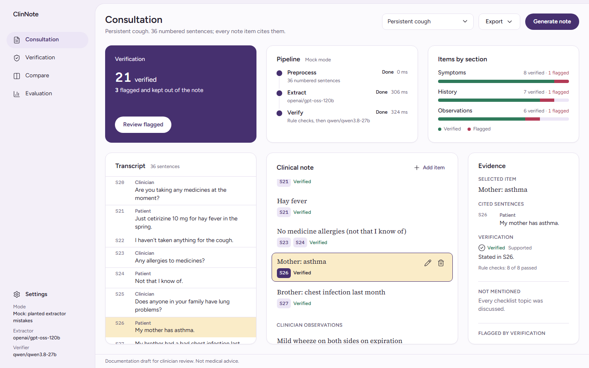
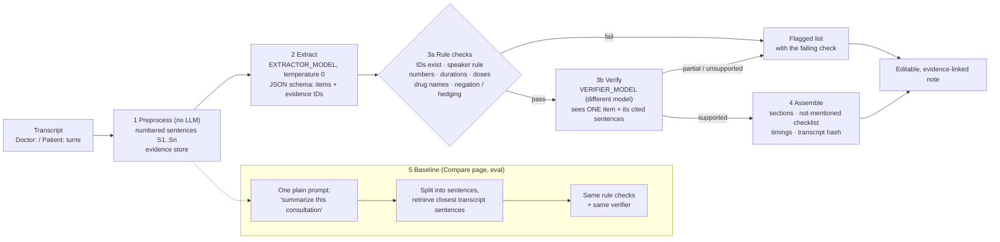

# ClinNote

**Evidence-linked clinical note drafting from consultation transcripts.**
Problem statement PS 57: Clinical Consultation Documentation Assistant.

ClinNote turns an anonymized doctor–patient transcript into an **editable** clinical note with
three sections: patient-reported symptoms, history, and clinician observations. Its hard rule:
**the note never contains a finding that is absent from the transcript.**

It enforces that rule by construction rather than by asking the model nicely:

- Every note item cites numbered transcript sentences (`S4`, `S7`).
- A **second, independent model** re-checks each item against **only its cited sentences**,
  after deterministic rule checks on IDs, speakers, numbers, durations, doses, drug names and
  negation.
- Anything that fails is **removed from the note and listed with the reason**. Topics never
  discussed are listed explicitly as "Not mentioned in consultation", never left blank.



> Documentation draft for clinician review. Not medical advice. All data in this repository is
> synthetic; there is no real patient data anywhere.

---

## Quick start

Prerequisites: **Python 3.11** and **Node.js 20+**.

```bash
python run.py
```

That one command creates `backend/.venv`, installs the Python and npm dependencies, creates
`backend/.env` from `.env.example`, starts the API on port 8000 and the web app on port 5173,
and opens <http://127.0.0.1:5173>. Ctrl+C stops both.

Without a key it starts in **mock mode**: it replays responses recorded from a live run, needs
no key, and works offline. For live mode, add a free Groq key from
<https://console.groq.com/keys>:

```powershell
powershell -File backend/scripts/set-groq-key.ps1   # hidden input; writes backend/.env
python run.py
```

Or edit `backend/.env` by hand (`LLM_MODE=live`, `GROQ_API_KEY=...`). If live mode is set but
the key is empty, `run.py` says so and starts in mock mode.

| Option | Effect |
|---|---|
| `python run.py --mock` | Mock mode: replays a recorded live run (real model output) |
| `python run.py --planted` | Mock mode with hand-made fixtures containing planted extractor mistakes (demo) |
| `python run.py --setup` | Install dependencies only |
| `python run.py --no-browser` | Do not open a browser tab |

---

## How it works



1. **Preprocess** (deterministic). Parses `Doctor:` / `Patient:` turns (also `Dr:`, `Clinician:`,
   `Pt:`), splits sentences without breaking "Dr.", "e.g.", "p.m." or "37.1", and assigns IDs
   `S1..Sn`. The transcript hash keys the cache.
2. **Extract.** The extractor model gets the numbered transcript and returns items as strict
   JSON: section, text, polarity (`present | absent | uncertain`), qualifiers (duration,
   severity, onset), and evidence IDs. The prompt
   ([backend/app/prompts/extract.v1.md](backend/app/prompts/extract.v1.md)) forbids inference
   and diagnosis, and asks for fewer items over guesses.
3. **Verify.**
   - **(a) Rule checks** ([backend/app/verify.py](backend/app/verify.py)), with normalization in
     [normalize.py](backend/app/normalize.py):

     | Check | Rule |
     |---|---|
     | Evidence present, IDs exist | At least one cited ID, all real |
     | Speaker | Symptoms cite **patient** sentences; observations cite **clinician** sentences; history may cite either |
     | Numbers | Every number in the item appears in its cited text ("five" = 5, "128/82", scale denominators like "/10" ignored) |
     | Durations | "5 days" = "five days", "a week" = 1 week; "5 weeks" ≠ "five days" |
     | Doses | "10mg" = "10 milligrams"; mcg, ml, puffs, tablets |
     | Drug names | Case-insensitive; a built-in list plus common suffixes (-pril, -statin, -triptan…) |
     | Polarity | "absent" needs a negation in the cited text; "uncertain" needs a hedge; "present" fails if every mention is negated |

   - **(b) Verifier model.** If (a) passes, an independent model sees only the item and its
     cited sentences, never the whole transcript, and returns
     `supported | partial | unsupported` with a reason. Partial or unsupported means flagged.
     If a rule check already failed, the model is not called, which saves free-tier quota.
4. **Assemble.** Verified items are grouped by section. `not_mentioned` is computed **in code**
   from a fixed checklist (duration, severity, medications, allergies, past conditions, family
   history, vital signs, examination findings), never by the LLM. A denial ("no allergies")
   counts as discussed.
5. **Baseline.** A naive "summarize this consultation" prompt with no citations, used on the
   Compare page and in the evaluation to show what an unconstrained summary invents.

**Free-tier behaviour.** Requests have retries with exponential backoff that honours
`retry-after`, and fail fast with a clear message when the daily quota is used up. At most
2 requests run at once. Up to 2 corrective retries are made on malformed JSON. Each model call
is cached on disk, so a run cut short by a rate limit resumes without repeating calls, and
whole notes are cached by transcript hash plus models plus prompt text.

### The UI

| Page | What it shows |
|---|---|
| **Consultation** | Verification summary, live pipeline stages with timings, items per section; numbered transcript, serif note with evidence chips, and an Evidence panel. Hover or click an item to highlight and scroll to its sentences; click a sentence to highlight every item citing it, flagged ones included. Inline editing keeps evidence attached and marks the item "Edited"; items you add show "No source sentence". Export as plain text, Markdown, or print/PDF, all with evidence IDs. |
| **Verification** | Every flagged item: what the extractor claimed, its cited sentences verbatim, which rule check failed and why, and the verifier model's reason. |
| **Compare** | The plain summary next to ClinNote. Sentences the verifier could not confirm are underlined; the label opens the reason and the transcript sentences checked. |
| **Evaluation** | The saved evaluation report: metrics, verifier audit, per-consultation counts, and what the plain summary added. |

Design rules (tokens, type, icon use, what is forbidden) are in [CLAUDE.md](CLAUDE.md). The
Tailwind theme resets the default palette, radii and shadows, so only design-token utilities
exist.

---

## Models

Set by `EXTRACTOR_MODEL` and `VERIFIER_MODEL` in `backend/.env`. They must be **different
models**; the backend refuses to start otherwise.

| Role | Default | Why |
|---|---|---|
| Extractor (and baseline) | `openai/gpt-oss-120b` | Groq production model; strict JSON-schema decoding |
| Verifier | `qwen/qwen3.8-27b` | Different developer (Alibaba vs OpenAI), so the check is independent; strict JSON-schema decoding |

These were chosen from Groq's model and deprecation pages on 2026-11-25 and confirmed
available on the live `GET /openai/v1/models` list the same day. Llama 3.x, Llama 4, Kimi and
Qwen 3/3.6 have been shut down on the free tier. `qwen/qwen3.8-27b` is labelled *preview*; if it
is withdrawn, set `VERIFIER_MODEL=openai/gpt-oss-20b` (production, but the same family as the
extractor). Hidden reasoning is kept short (`reasoning_effort` low or none) because it counts
against tokens per minute.

---

## Evaluation

Six synthetic consultations (32–36 sentences each) with **traps**:
- denials ("No fever")
- hedges ("maybe a week", "I think")
- a relative's condition that must not become the patient's history
- a patient's guess that contradicts the clinician
- no vital signs in three of the six

Hand-written gold annotations (`backend/data/gold/`, source in
`backend/eval/gold_source/build_gold.py`) list 118 expected facts with section, polarity and
evidence, the plan and other facts that are allowed but not scored, and 20 traps.

`python -m eval.run_eval` scores three systems against gold. **Gold is the judge, not our own
verifier**, so the evaluation is not circular.

- **Plain summary:** one "summarize this consultation" prompt, same model as the extractor.
- **Extractor only:** ClinNote's extraction before verification.
- **ClinNote:** after rule checks and the verifier model.

### Results (live run, 2026-11-25; extractor `openai/gpt-oss-120b`, verifier `qwen/qwen3.8-27b`)

| Metric | Plain summary | Extractor only | ClinNote |
|---|---:|---:|---:|
| Supported-item rate | 77% (61/79) | 100% (117/117) | 100% (103/103) |
| Unsupported claims per note | 3.00 | 0.00 | 0.00 |
| Section-placement accuracy | 51% | 97% | 97% |
| Negation / uncertainty preserved | 77% (30/39) | 88% (35/40) | 91% (32/35) |
| Gold facts covered | 92% (109/118) | 96% (113/118) | 86% (102/118) |

These are the numbers the script produced (`backend/data/eval/latest.json`, shown on the
Evaluation page). What they say:

- **The plain summary invents things.** 18 of its 79 sentences have no support, 7 of them
  falling into traps. Examples:
  - a made-up "28-year-old" and "55-year-old male with type 2 diabetes"
  - diagnoses the clinician never made (migraine, exertional angina, appendicitis, neuropathy)
  - the patient's guess "due to the cold weather" stated as the cause

  It also loses section structure (51%) and drops hedges and denials (77%).
- **Citation-constrained extraction did most of the work.** Asked to cite sentences and forbidden
  to infer, the extractor made **no** unsupported claims on these six consultations, and placed
  97% of items in the right section.
- **The verification step, on this data, cost recall without a measurable faithfulness gain.**
  The extractor gave it nothing to catch: 0 unsupported items. It removed 14 of 117 correct
  items, which cut gold coverage from 96% to 86%. The removed items stay visible on the
  Verification page, so nothing is silently lost, but they are not in the note.
- **Why the verifier over-flags: context-dependent citations.** The verifier sees only the cited
  sentences, by design. The extractor often cited just the answer:
  - "No, that's normal." for *No burning on urination*
  - "It comes on when I walk up the hill." for *Chest tightness triggered by walking uphill*
  - a drug named one sentence earlier than the cited one

  The verifier correctly refuses to confirm from fragments. 11 of the 14 can be fixed by having
  the extractor also cite the sentence that gives the context. The other 3 are symptom denials
  that answer a clinician's question; citing the question is blocked by the rule that symptoms
  cite patient sentences only.
- **The verifier still earns its place as a guard.** Gold cannot show this here because the
  extractor made no mistakes. With planted extractor mistakes (`python run.py --planted`, the
  test fixtures), the rule checks and verifier catch all 18: a relative's asthma written as the
  patient's, an invented "3 days", a patient's question recorded as a finding, a wrong dose,
  and more.

Honest caveats:
- Six transcripts, written alongside the system.
- Matching is by term lists. Plain-summary claims have no citations, so they are matched on text
  alone, a more lenient test.
- Three gold paraphrases ("unremarkable", "discontinue", "neck moves freely") were added after
  the first run, for all systems alike. They are in git history.
- The verifier also flagged 57 of the plain summary's 79 sentences (gold: 18 unsupported). Its
  verdicts on the summary are strict because the evidence it gets is retrieved, not cited.

Re-run it yourself: `python -m eval.run_eval` (cached calls make re-runs fast;
`--record-fixtures` also refreshes the offline fixtures).

---

## Demo script (about 3 minutes)

Start with planted extractor mistakes so every safeguard has something to catch. The sidebar
says "Mock: planted extractor mistakes".

```bash
python run.py --planted
```

`python run.py --mock` replays the real recorded live run instead, which is the models' actual
output. `python run.py` with a key runs live.

1. **Open on the empty state.** "Six synthetic consultations, or paste your own. Nothing real."
2. **Click "Persistent cough".** Watch Preprocess, Extract and Verify complete with timings.
   "21 verified, 3 flagged and kept out of the note."
3. **Hover "Cough", then click "Mother: asthma".** The transcript scrolls to S26 and highlights
   it. "Every line in the note points at the words it came from."
4. **Click sentence S26 in the transcript.** The Evidence panel shows two items cite it:
   "Mother: asthma", verified, and "Asthma", flagged. "The extractor also wrote the mother's
   asthma as the patient's own. The verifier, seeing only S26, rejected it."
5. **Open Verification** (Review flagged). Walk the three rows: an invented "3 days" stopped by
   the duration check; the asthma caught by the verifier model; a patient's question
   ("Do you think it's a chest infection?") stopped by the speaker rule.
6. **Back on Consultation, show "Not mentioned"** on a sample without vitals (Recurrent
   headache): "Allergies, Vital signs" are listed, not silently left out.
7. **Edit an item.** The chips stay attached and it is marked "Edited". **Add an item**: it is
   marked "No source sentence".
8. **Open Compare, generate the plain summary.** Point at the underlined "History of asthma"
   and an invented diagnosis; open a label to show the reason.
9. **Open Evaluation.** These are the real live results, not the planted demo: the plain
   summary invents about 3 statements per note; ClinNote none. Be candid that on real output
   the verifier over-flagged context-dependent citations, and explain why.
10. **Export > Download Markdown.** Evidence IDs travel with the note.

---

## API

| Method | Path | Returns |
|---|---|---|
| GET | `/health` | Mode and model names |
| GET | `/samples`, `/samples/{id}` | Bundled synthetic transcripts |
| POST | `/generate` | `{transcript}` or `{sample_id}` gives a Note plus sentences. With `Accept: text/event-stream`, streams `stage` events then `result` (or `error`) |
| POST | `/baseline` | Plain summary with per-sentence verdicts |
| GET | `/eval` | Latest saved evaluation report |

Errors are `{code, message}` with a plain-language message, shown as-is in the UI. Codes:
`empty_transcript`, `no_speakers`, `transcript_too_long`, `rate_limited`, `bad_llm_output`,
`llm_unavailable`, `mock_fixture_missing`, `eval_missing`.

---

## Development

```bash
# Backend (from backend/)
.venv/Scripts/python -m pytest          # 172 tests (use .venv/bin/python on macOS/Linux)
.venv/Scripts/ruff check app tests eval
.venv/Scripts/mypy app tests eval       # strict

# Frontend (from frontend/)
npm test            # Vitest: evidence linking, polarity text, editing, export, SSE parsing
npm run typecheck
npm run lint        # oxlint
npm run shots       # Playwright screenshots at 1440 and 1280 into design/shots, plus axe
                    # (WCAG 2.1 A/AA) on every view; fails on any violation

# Evaluation and fixtures (from backend/)
python -m eval.run_eval                     # uses LLM_MODE from .env
python -m eval.run_eval --record-fixtures   # live: also saves responses as mock fixtures
python -m eval.build_mock_fixtures          # rebuild hand-made test fixtures (tests/fixtures)
```

Prompts are versioned files in `backend/app/prompts/` (`extract.v1.md`, `verify.v1.md`,
`baseline.v1.md`). The version is recorded in every note's `meta`, and the prompt text is part
of the cache key.

### Layout

```
clinnote/
  run.py                    one-command local run
  CLAUDE.md                 project rules and design system
  design/shots/             design-QA screenshots (npm run shots)
  backend/
    app/                    main, schemas, preprocess, extract, verify, normalize, assemble,
                            baseline, evaluation, llm (Groq + mock + recorder), cache, prompts/
    data/transcripts/       6 synthetic consultations
    data/gold/              gold annotations: items, allowed facts, traps
    data/fixtures/          mock-mode responses, recorded from a live run
    data/eval/latest.json   latest evaluation report (served by GET /eval)
    eval/                   run_eval.py, build_mock_fixtures.py, gold_source/ (gold builder)
    scripts/                set-groq-key.ps1
    tests/                  pytest; tests/fixtures holds hand-made responses with planted
                            extractor mistakes, so every check has something to catch
  frontend/
    src/                    components/, pages/, lib/ (evidence linking, export, format), state/
    scripts/shots.ts        Playwright screenshots + axe
```

---

## Limitations

- **Synthetic data only, six transcripts.** The evaluation is small and the gold annotations
  were written by the same team that built the system. Treat the numbers as a sanity check,
  not a benchmark.
- **Gold matching is keyword-based.** Statements are matched to gold facts by term groups, plus
  citations (ClinNote), polarity and numbers. Plain-summary claims have no citations, so they
  are matched on text alone, a more lenient test, and paraphrases the term lists miss count as
  unsupported. Unsupported examples are listed on the Evaluation page so this can be checked.
- **Rule checks are heuristics.** The drug list is short; negation scope is a five-word window
  within a clause. "I have no idea why my head hurts" could flag a headache as negated. A false
  flag only sends an item for clinician review; it never adds content.
- **The verifier over-flags context-dependent citations.** In the live run it removed 14 of 117
  correct items (see Evaluation), mostly answers cited without their question, or pronouns cited
  without their antecedent. They stay visible on the Verification page. The fix is an extractor
  prompt v2 that also cites the context sentence. For symptom denials that answer a clinician's
  question, it would also need a speaker rule that lets a symptom cite that question as
  context.
- **Recall is not guaranteed.** The design trades recall for faithfulness: a missed finding is
  absent from the note, not invented. The "Not mentioned" list covers the checklist topics
  only.
- **Edited items are not re-verified.** Editing keeps evidence attached and marks the item
  "Edited"; the original verification no longer applies to the new wording.
- **English, two speakers, text transcripts.** Audio input (Whisper) was optional and is not
  built.
- **Free-tier limits.** About 30 requests and 8K tokens per minute per model. A full live
  evaluation takes several minutes; caching makes re-runs fast.

---

## Data and safety

All transcripts are synthetic and written for this project. Do not paste real patient data;
the paste box says so. The output is a **documentation draft for clinician review, not medical
advice**, and every screen and export carries that line.
